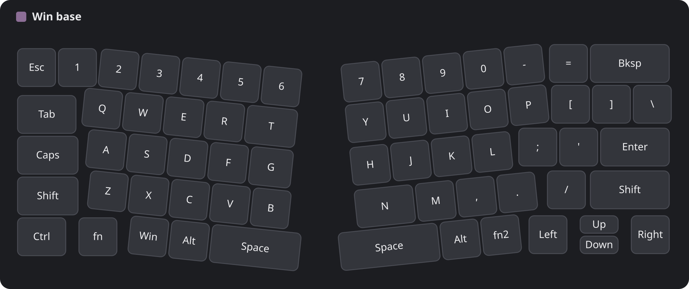
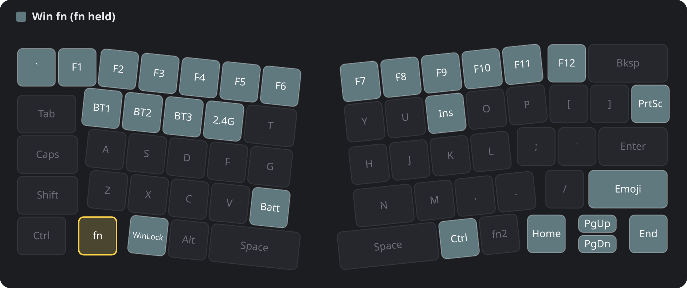

# ZMK for the Keychron B11 Pro

Custom [ZMK](https://zmk.dev) firmware for the **Keychron B11 Pro** (65% Alice, foldable, Realtek RTL8762G,
USB `3434:07b0`), built on [Keychron's ZMK fork](https://github.com/keychron/zmk). Keychron has not published
a shield or a way to flash one for this board. This repo has both: the shield, and a host tool that flashes
over USB with no SWD, no case opening and no Keychron Launcher upload.

> **Risk.** You are replacing your keyboard's firmware. If the new image does not boot, the only known
> recovery is UART download mode with the case open, and nobody has confirmed the pads are reachable. A
> custom image that boots and enumerates over USB can always be swapped back to stock with the same tool.
> Keep the stock image on disk first, and read "Before you flash". No warranty.

## Status

| link / feature | state |
| --- | --- |
| USB | works: all keys, the 6 stock layers, NKRO, consumer keys |
| Bluetooth | works: 3 slots, battery report |
| KeyPeek / VIA raw HID | works over USB and over Bluetooth (see "KeyPeek", optional) |
| ghost filter | the matrix has no diodes; a software filter handles three-key rectangles |
| **2.4G (Link-KM receiver)** | **does not work.** The stock framing is reproduced, but the connection fails inside Realtek's closed link library. Stock firmware still works with the receiver, so flashing back restores it |
| fold | closing the board cuts power in hardware, so the Bluetooth link drops (same as stock) |
| LEDs | battery LED only, no per-key lighting on this board |

The keymap in `app/boards/shields/keychron_b11_pro_ansi/` is the stock one: all 6 layers (Mac base, Mac fn,
Mac fn2, Windows base, Windows fn, Windows fn2) with the same 70 bindings as Keychron's 1.0.0 firmware, read out
of that image. The Mac/Win switch on the board selects the Mac or Windows base layer, as on stock. Copy and edit
it to taste. The six layers were checked against the stock image binding by binding (6 x 70, all equal),
but this exact build has not been flashed. The firmware ran on a board with a different keymap and a few extras that
I left out of this repo: if you flash it, tell me how it went.

### Dynamic macros (extra, not in the stock keymap)

The firmware has record-and-replay macros as the `&dm` behavior: 2 slots of 128 keystrokes each. Bind keys like
these in your keymap (the same idea as QMK's dynamic macros):

```text
&dm DM_REC 0    start recording into slot 0 (overwrites it)
&dm DM_STP 0    stop recording (stops whichever slot is recording)
&dm DM_PLY 0    replay slot 0
```

Use slot 1 for the second one (`&dm DM_REC 1`, `&dm DM_PLY 1`). Slots are kept in RAM and lost at power-off.

## Build

Linux x86_64 or macOS on Apple Silicon (the post-build step uses Realtek's `prepend_header` binary).
You need `git`, `cmake`, `ninja`, `dtc`, Python 3 with `pip`, and the GNU Arm Embedded toolchain
(`arm-none-eabi-gcc` with newlib; on Arch `arm-none-eabi-gcc arm-none-eabi-newlib`).

```bash
python3 -m venv .venv
. .venv/bin/activate
pip install west
git clone https://github.com/YuyQuan/zmk-keychron-b11-pro zmk
cd zmk
west init -l app
west update
pip install -r zephyr/scripts/requirements-base.txt
```

`west update` fetches Keychron's Zephyr fork and the Realtek HAL into `zephyr/` and `modules/` inside the clone
(about 2 GB, git-ignored). Then build from `app/`:

```bash
cd app
export ZEPHYR_TOOLCHAIN_VARIANT=gnuarmemb
export GNUARMEMB_TOOLCHAIN_PATH=/usr
unset ZEPHYR_SDK_INSTALL_DIR
west build -b keychron -- -DSHIELD=keychron_b11_pro_ansi
```

Set `GNUARMEMB_TOOLCHAIN_PATH` to the directory that holds `bin/arm-none-eabi-gcc` (`/usr` for a distro
package). Use the default build directory `app/build`: the post-build step reads `app/build/zephyr/zmk.bin`
and prepends the 0x500-byte OTA header to it in place. **`app/build/zephyr/zmk.bin` is the file to flash**
(about 280 KB). Rebuild after editing the keymap with the same `west build` line.

## Before you flash

1. Get the stock image from Keychron's B11 Pro firmware page (`b11pro_v1.0.0_ansi_..._ota.bin`) and keep it.
   It is your way back.
2. Put the mode slider on **USB** and use the cable. USB only comes up if the slider is on USB at boot, in
   stock and in this firmware.
3. Linux needs access to the board's hidraw node. Either run the tool with `sudo`, or add a udev rule:

```text
SUBSYSTEM=="hidraw", ATTRS{idVendor}=="3434", ATTRS{idProduct}=="07b0", TAG+="uaccess"
```

   (save as `/etc/udev/rules.d/50-keychron.rules`, then `sudo udevadm control --reload && sudo udevadm trigger`
   and replug).

## Flash

```bash
python3 b11-pro/b11_dfu.py query
python3 b11-pro/b11_dfu.py send app/build/zephyr/zmk.bin
python3 b11-pro/b11_dfu.py send app/build/zephyr/zmk.bin --switch
```

- `query` is read-only: it prints the model (`KCZKB11K`), DFU version and patch versions. Run it first to
  check the board is found.
- `send FILE` uploads to the board's temporary slot and checks CRC32 and SHA-256. It stops there; the running
  firmware is untouched. Use it as a dry run.
- `send FILE --switch` does the same, then tells the board to install the image and reset. This is the point of
  no return. It takes about 45 seconds; the board re-enumerates as `3434:07b0`.

To go back to stock, run the same `--switch` command with the stock `.bin`.

If the first keys look wrong after a flash (a layout or pin problem in a shield is the usual cause), flash stock
again over USB. That works as long as the custom image enumerates, which it does if USB works at all.

## How flashing works

The running firmware has its own update channel on HID interface 2 (usage page 0x8c). There is no "enter DFU"
step, which is why a boot key is no use here (`&bootloader` and Keychron's KC_BOOT are only a chip reset on this
chip): the keyboard in normal operation already accepts an image. The
device checks CRC32, SHA-256 and an 8-byte name (`KCZKB11K`); there is no signature, even on the stock image.
Protocol, opcodes and what is verified: [b11-pro/dfu-protocol.md](b11-pro/dfu-protocol.md).

The recovery limit is that after `IMAGE_SWITCH` the vendor boot code decides. A custom app that crashes before
USB comes up cannot be replaced over USB. Realtek's boot ROM has a UART download mode (strap P0_3 low at
reset, UART on P3_0/P3_1), but whether the B11 Pro exposes those as pads is unknown. Keep your image changes
away from USB init and the DFU code (`app/src/dfu/`, `CONFIG_ENABLE_HID_INT_OUT_EP`, USB ids), which is what
keeps the way back open.

## Hardware notes

Pins, the 74HC595 column driver, the mode slider and the stock image format:
[b11-pro/hardware.md](b11-pro/hardware.md).

## KeyPeek (optional)

[KeyPeek](https://github.com/srwi/keypeek) is a separate desktop app (GPL-3.0, Linux, Windows, macOS) that
draws your keyboard on screen and shows the keys of the layer you are holding, so you can see what fn does
without memorising it. **It is completely optional.** The firmware and keymap work the same without it, and
there is nothing to switch on in the keyboard: it only talks to KeyPeek while KeyPeek is running (an idle
board sends nothing).

This is what it shows for the stock keymap. These two pictures are illustrations drawn from this repo's layout
and keymap in KeyPeek's style, not screenshots; KeyPeek's own demo is in
[its README](https://raw.githubusercontent.com/srwi/keypeek/master/.github/assets/demo.gif).

Windows base layer, the default view if you let KeyPeek show every layer:



Holding fn: keys that do something on the fn layer light up, everything else is dimmed, and the key you are
holding is outlined. Here fn+1..= give F1-F12, fn+Q..R pair Bluetooth slots 1-3 and 2.4G, fn+B shows the battery
and fn+Win is a Keychron key I believe is the Win-key lock:



### Set it up

1. Download KeyPeek (0.10.0 is the version I use) from its [releases page](https://github.com/srwi/keypeek/releases) and run it.
2. Linux only: the app needs read/write access to the board's raw HID interface. The udev rule from "Before you
   flash" already covers USB. For Bluetooth the HID device has no USB vendor id, so it needs its own rule
   (`MODE="0666"` is what I use; any local user can then read it, so use `TAG+="uaccess"` if that bothers you):

```text
KERNEL=="hidraw*", SUBSYSTEM=="hidraw", KERNELS=="0005:3434:*", MODE="0666"
```

3. Plug the keyboard in over USB (or pair it over Bluetooth; if you paired it before flashing this firmware,
   remove the pairing and pair again, BlueZ caches the HID report map). Start KeyPeek (it scans for
   devices at launch, so plug in first) and pick the **Keychron B11 Pro** in its device list.
4. KeyPeek asks for a `keyboard_info.json` because VIA does not carry the key positions. Choose
   [`b11-pro/keypeek/keyboard_info.json`](b11-pro/keypeek/keyboard_info.json) from this repo (built from Keychron's
   own Launcher layout for this board).
5. In KeyPeek's settings choose which layers pop up the overlay. For the stock keymap the useful ones are the
   fn layers (1, 2, 4, 5); leave 0 and 3 off or the overlay appears all the time. KeyPeek saves this per keyboard.

If you prefer to edit the settings file (`~/.config/keypeek/settings.ini` on Linux), the board entry looks like
this, with `visible_layers` as a bitmask of layer numbers (0x36 = layers 1, 2, 4, 5):

```ini
[board 3434:07b0]
json=/path/to/zmk-keychron-b11-pro/b11-pro/keypeek/keyboard_info.json
visible_layers=0x00000036
activation_delay=0
```

I run KeyPeek as a user service so it is always there. Stock KeyPeek has no start-up connect option, so that
needs a small patch of its own; the manual steps above are all you need.

`keyboard_info.json` also carries a non-standard `keypeek` block (layer names and Keychron key labels such as
BTH1 and Opt). Only KeyPeek builds that read it show those names; stock KeyPeek ignores the block and shows
layer numbers. KeyPeek does not work over 2.4G, which does not work at all yet.

## Layout of this repo

This is a branch of Keychron's ZMK fork. Everything outside the files below is theirs (and ZMK's upstream
README is kept as `README.zmk.md`).

- `app/boards/shields/keychron_b11_pro_ansi/`: the shield (devicetree overlay, config, stock keymap).
- `app/module/drivers/kscan/`, `app/src/`: the B11 matrix driver, the ghost filter, Bluetooth fixes, raw HID over
  BLE, KeyPeek notifications, the `&dm` dynamic-macro behavior.
- `b11-pro/`: flash tool, protocol and hardware notes, KeyPeek files and pictures.

Licence: MIT, as ZMK. The Realtek HAL and `prepend_header` are Realtek's and come with their own terms.
